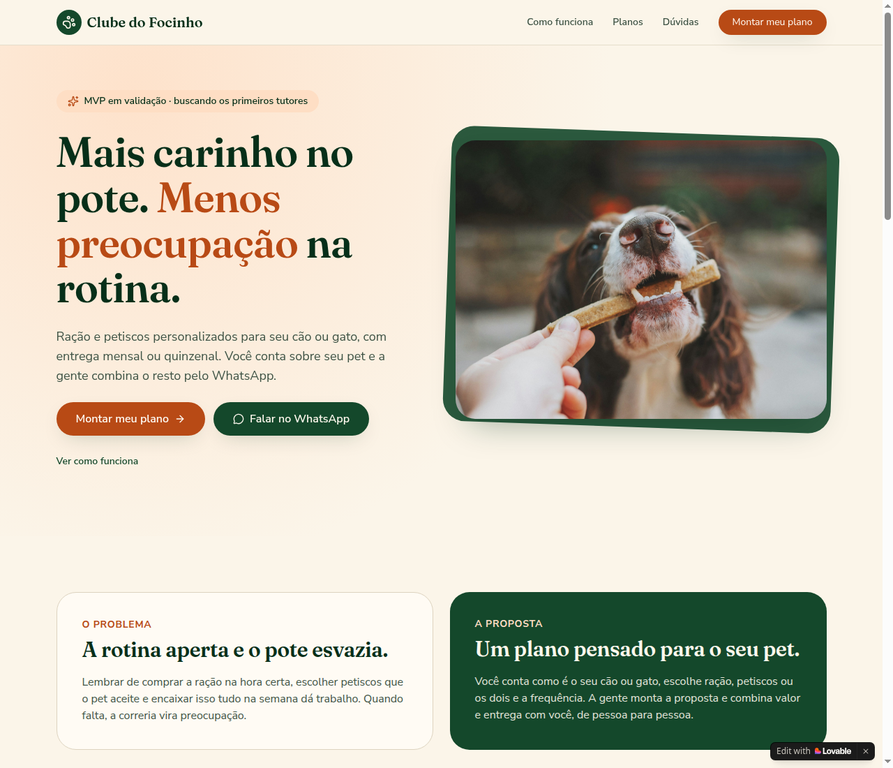
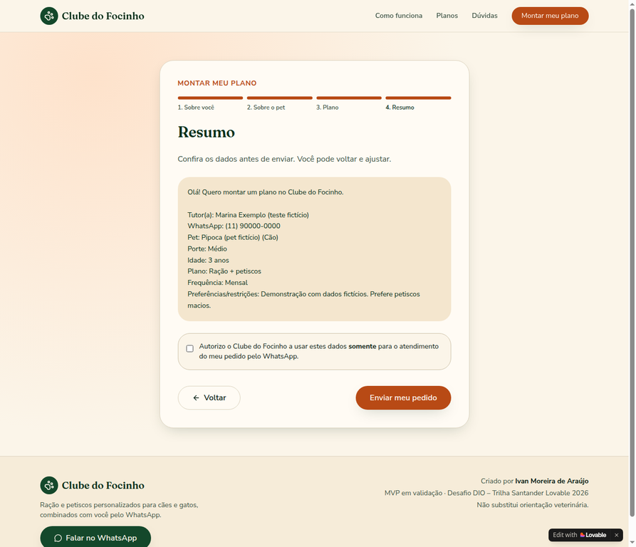
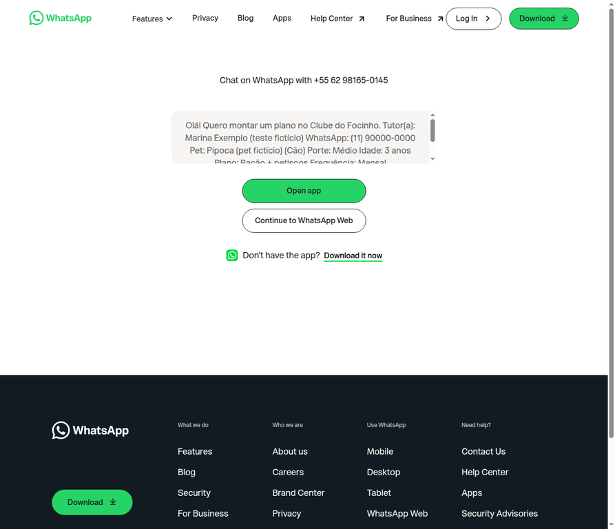
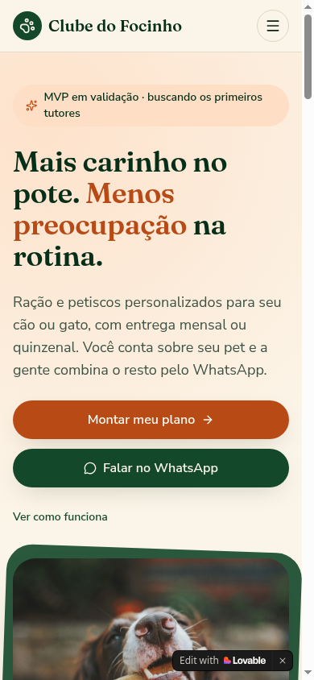

# Clube do Focinho

MVP em validação de **Ivan Moreira de Araújo**, para o desafio **DIO — Trilha Santander Lovable 2026**.

**[Abrir aplicação publicada](https://clube-do-focinho-planner.lovable.app/)** · **[Repositório](https://github.com/ivan419419/meunegocio-ai-mvp)**

> **Este repositório contém somente documentação e evidências. O código-fonte da aplicação ainda NÃO está neste repositório.** A sincronização Lovable–GitHub não foi concluída. Os arquivos de código serão adicionados quando os créditos do Lovable voltarem e a exportação/sincronização puder ser concluída. Por enquanto, não há arquivos para instalar ou executar o app localmente.

## A ideia

O Clube do Focinho propõe um serviço personalizado de ração e petiscos para cães e gatos, com entrega quinzenal ou mensal. O tutor informa sobre si, seu pet e o plano desejado; valor final, pagamento e entrega são combinados por atendimento humano pelo WhatsApp.

**Não há pagamento pelo site.** A proposta não substitui orientação veterinária.

## Fluxo demonstrado

1. Acessar a landing e clicar em **Montar meu plano**.
2. Preencher as etapas **Sobre você**, **Sobre o pet** e **Plano**.
3. Conferir os dados na etapa **Resumo**.
4. Preparar a conversa de WhatsApp com o resumo do plano.

A demonstração usa apenas dados fictícios: **Marina Exemplo**, telefone de teste **(11) 90000-0000**, e o cão **Pipoca**, porte médio, 3 anos, plano mensal de ração + petiscos. Nenhuma mensagem foi enviada. O botão **Enviar meu pedido** também não foi acionado: não foi concluído um cadastro/pedido de teste no servidor.

## Quatro capturas reais

### 1. Landing com o botão “Montar meu plano”

### 2. Formulário preenchido — resumo de tutor e pet fictícios

### 3. WhatsApp com a mensagem pronta, sem envio

Prévia oficial do WhatsApp para o número configurado na aplicação, **+55 62 98165-0145**, aberta com o mesmo texto do resumo fictício. Esta é a página de prévia/encaminhamento do WhatsApp, não uma conversa enviada nem uma confirmação de entrega. O link foi aberto diretamente para evitar registrar um pedido fictício no servidor do app.

### 4. Landing em viewport móvel

Captura real no navegador com viewport de **390 × 844 px**, simulando uma tela de celular. Não é foto de um aparelho físico e não representa uma correção de responsividade.

## Estado atual e pendências

- Aplicação publicada e acessível pelo link acima.
- Código-fonte ainda pendente de exportação/sincronização e inclusão neste repositório.
- Correção de corte/layout mobile **pendente**.
- Área administrativa (**Admin**) **pendente**.
- Nesta documentação não foi validado o envio final de pedidos nem o recebimento de mensagens.

## Links para preenchimento na DIO

- **Link da aplicação:** https://clube-do-focinho-planner.lovable.app/
- **Repositório:** https://github.com/ivan419419/meunegocio-ai-mvp

A entrega na DIO deve ser feita pelo autor. Um repositório apenas documental não garante atendimento às exigências do desafio nem aceitação pela plataforma.
